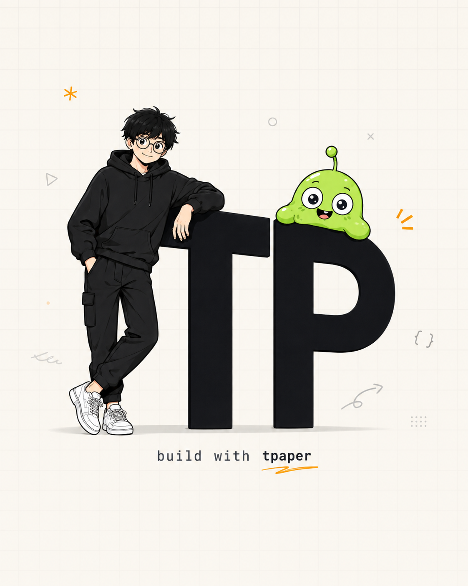

# TPaper 2.0 — AI-Native 交互式试卷生成引擎

<p align="center">
  
</p>

<p align="center">
  <strong>把任意试卷（PDF · DOCX · 扫描件 · 图片 · TXT）一键生成为可即刻作答、自动批改、KaTeX 矢量公式渲染与分步解析的独立单文件 HTML 试卷产物。</strong>
</p>

---

## ⚡ 核心理念

传统教育软件依赖繁琐的题目录入与庞大题库。**TPaper 2.0** 采用 **AI Agent 即时构建（Just-in-Time Generation）** 与 **HTML Artifact 单文件产物** 架构：

- 📄 **文档零门槛摄入**：拖拽任意 PDF、Word 或扫描图片，内置多模态引擎自动提取题干、选项、公式与结构。
- 🤖 **Agent 智能分步解析**：调用通义千问（Qwen）多模态大模型，深度推导解题步骤并生成【考查知识点】、【详细推导】与【易错警示】。
- 📦 **单文件 HTML Artifact**：自包含 KaTeX 矢量数学公式渲染、计时器、自动评分与抽屉式解析，可直接导出为单文件离线作答或通过短链分享。
- 🎨 **Neobrutalism 品牌视觉**：米白草稿纸纹理（`#FAF7F1`）、深墨黑硬边框（`#0F1115`）、能量荧光橙高亮（`#FF9D1A`）与灵动 Mascot 互动。

---

## 🛠️ 技术栈

- **框架**: Next.js 15 (App Router, Turbopack) + React 19 + TypeScript
- **样式**: Tailwind CSS + Framer Motion (Neobrutalism 风格体系)
- **大模型接入**: 阿里云 DashScope 通义千问 (Qwen-Turbo / Qwen-Plus)
- **文档解析**: `unpdf` 零 Worker 纯服务端 PDF 提取引擎 + `jsonrepair` 容错修复
- **公式渲染**: KaTeX 矢量数学公式系统
- **测试与验证**: `ego-browser` 浏览器沙箱自动化 QA

---

## 🚀 快速启动

### 1. 克隆项目与安装依赖

```bash
git clone https://github.com/TPGoFighting/TPaper-2.0.git
cd TPaper-2.0
npm install
```

### 2. 配置环境变量

复制 `.env.example` 为 `.env.local`：

```bash
cp .env.example .env.local
```

填写你的 DashScope API Key：

```env
QWEN_API_KEY=your_dashscope_api_key
QWEN_BASE_URL=https://dashscope.aliyuncs.com/compatible-mode/v1
QWEN_MODEL=qwen-turbo
```

### 3. 运行本地开发服务器

```bash
npm run dev
```

打开浏览器访问 [http://localhost:3000](http://localhost:3000)。

---

## 📚 详细设计文档

- [00_产品定义与核心链路](./00_tpaper_product_definition.md)
- [01_官网信息架构与交互动效](./01_tpaper_website_design.md)
- [02_品牌视觉设计系统](./02_tpaper_brand_visual_system.md)
- [03_Agent 状态机与流水线](./03_tpaper_agent_workflow.md)
- [04_技术架构与单文件产物模型](./04_tpaper_technical_architecture.md)

---

## 📄 开源协议

MIT License.
